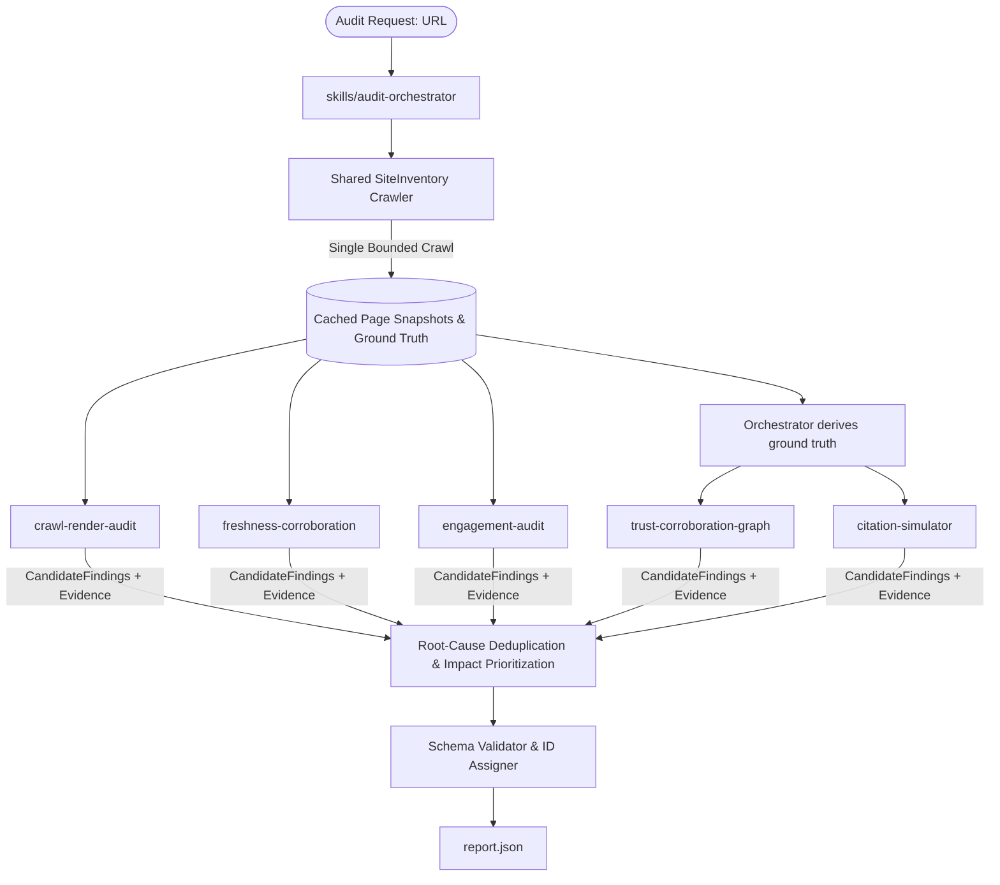

**Tech stack:** Python 3.10+ · Python standard library · JSON Schema · setuptools · CLI · Read-only HTTP crawling

**An evidence-driven Agent Skill Marketplace for AI discoverability and on-site engagement.**

Crawl a website once · run focused audit skills · produce a validated JSON report

CiteSense audits arbitrary websites for the conditions that determine whether AI systems
can find, understand, trust, and cite a brand—and whether visitors can successfully engage
after arriving. It was built for the Adobe University Hackathon 2026 Round 3.

Marketplace name `citesense`, entrypoint `audit-orchestrator`, six skills. The manifest name,
this README and the repository directory all use the same identity, so the zip root, the manifest
and the docs agree.

> **Two interfaces:** this repository is the Adobe Agent Skill Marketplace; the published
> Python package is a convenient way to run the same engine. Installing the package does not
> automatically register the marketplace skills with an AI platform.


## Quick start


### Run from PyPI

```bash
python -m pip install --upgrade citesense
```

```bash
citesense audit https://example.com --output report.json
```


### Run the marketplace entrypoint

```bash
python skills/audit-orchestrator/scripts/run_audit.py \
  https://example.com \
  --output report.json
```

The marketplace command is the canonical Adobe submission flow: an agent reads
`marketplace.json`, selects `audit-orchestrator`, and invokes its single entrypoint.

### Use the Python API

The package exposes the existing orchestrator without duplicating its engine:

```python
from citesense import run_full_audit

report = run_full_audit("https://example.com")
print(report["summary"])
```


## What the audit returns

Every report contains:

- severity counts and a deterministic citability score;
- findings with status, confidence, impact, rationale, and prioritized fixes;
- an evidence ledger with stable IDs and finding references;
- assessment statuses such as `confirmed`, `likely-risk`, `inconclusive`, and `not-assessed`;
- proactive recommendations when the crawl provides a concrete basis;
- access, robots, page-selection, and limitation details.

The audit is read-only, enforces `robots.txt`, uses a bounded crawl, and never bypasses
CAPTCHA, WAF, login, or anti-bot protections. A typical run completes in seconds and stays
within the five-minute evaluation budget.

Optional external discovery evidence may be supplied by an agent, but CiteSense never performs
or fabricates search-engine or live AI results internally:

```bash
citesense audit https://example.com \
  --external-evidence external-evidence.json \
  --output report.json
```

If no external evidence is supplied, off-site discovery is reported as `not-assessed`.

Pre-generated reports for real sites are available in
`[validation-runs/](validation-runs/)`, with runtimes and severity counts in
`[validation-runs/RUNS.md](validation-runs/RUNS.md)`.

## Documentation

- [Case study: the site that passes its checks and is still invisible](docs/CASE-STUDY.md)

---


## Entrypoint

`skills/audit-orchestrator` is the single entrypoint that orchestrates the audit.
See `marketplace.json` for the full marketplace manifest.

## How an AI agent uses the marketplace

The intended agent flow is:

```text
User asks for a website audit
        ↓
Agent reads marketplace.json
        ↓
Agent reads audit-orchestrator/SKILL.md
        ↓
Agent invokes the single orchestrator entrypoint
        ↓
Orchestrator runs the specialist skills
        ↓
Agent receives report.json
```

The PyPI package and the marketplace are complementary:

- **Marketplace:** gives an AI agent the manifest, skill instructions, composition rules,
and specialist skill structure expected by the Adobe submission.
- **PyPI package:** gives developers a portable `citesense` command and Python API for
running the same audit engine.

Installing the PyPI package alone does not automatically register CiteSense with Claude,
Cursor, Antigravity, or another agent platform. The agent can still use it when instructed
to run the `citesense` command.

## Direct agent test prompt

Copy the following prompt directly into an AI coding agent to run a controlled CiteSense
1.1.0 audit of Adobe's website:

```text
Use CiteSense 1.1.0 to audit ONLY this website:

https://www.adobe.com/in

Do NOT substitute another website or URL.

First verify:

python -m pip install --upgrade --no-cache-dir citesense
python -c "import importlib.metadata; print(importlib.metadata.version('citesense'))"

The installed version must be 1.1.0 or newer.

Then run EXACTLY:

citesense audit https://www.adobe.com/in --output adobe-report.json

IMPORTANT:

- Do not audit IRCTC, example.com, Linkit, WebMakeDevs, or any other website.
- Do not replace the target URL if the audit encounters an access or network error.
- If Adobe cannot be accessed, report that CiteSense could not access the target and show
  the generated report/status.
- Do not invent or modify findings.
- Do not create findings for another website.

After the command finishes, read adobe-report.json.

Report:

1. Audited URL
2. Whether the site was accessible
3. Citability score, if assessed
4. Total findings
5. Critical / High / Medium / Low counts
6. Every finding with:
   - ID
   - title
   - severity
   - status
   - confidence
   - evidence
   - suggested action
7. Assessment statuses
8. AI discoverability issues
9. Citation-answerability issues
10. Trust/corroboration issues
11. Engagement issues
12. Proactive recommendations
13. Top 5 recommended fixes

Base everything strictly on adobe-report.json.

At the very beginning of the final response, print:

AUDITED URL: <actual URL>
REPORT FILE: adobe-report.json

If the actual audited URL is not https://www.adobe.com/in, STOP and report the mismatch
instead of analyzing the report.
```


## Project structure

```text
src/citesense/              # Public Python API and console adapter
skills/                     # Marketplace skills and the single audit entrypoint
marketplace.json            # Marketplace manifest (one entrypoint)
tests/                      # Unit, regression, package, and marketplace tests
pyproject.toml              # Install/build metadata
```


## Architecture & Skills




| Skill                               | Concern                                              | What it adds                                                                                                                                                                                                                                                                                                                                                                                                                                          |
| ----------------------------------- | ---------------------------------------------------- | ----------------------------------------------------------------------------------------------------------------------------------------------------------------------------------------------------------------------------------------------------------------------------------------------------------------------------------------------------------------------------------------------------------------------------------------------------- |
| **crawl-render-audit**              | Off-site discoverability, steps A-C                  | Is the crawler let in? Scored **by crawler class** -- blocking training crawlers (GPTBot, ClaudeBot) costs no citations and is a legitimate licensing stance; blocking search-index (OAI-SearchBot, Claude-SearchBot, PerplexityBot) or user-triggered (ChatGPT-User, Claude-User) agents is what makes a brand uncitable. Can it read the page without executing JS? Is structured data present and valid? Are facts locked inside images or canvas? |
| **freshness-corroboration**         | Temporal + internal consistency (Appendix D, half 1) | Claim-based freshness: detects actual stale/conflicting facts (e.g. conflicting founding years, expired promotions) instead of treating missing `dateModified` as a defect.                                                                                                                                                                                                                                                                           |
| **engagement-audit**                | On-site engagement                                   | Evaluates orientation, buttons/forms/CTAs, navigation, redirect-aware broken links, and mobile viewport.                                                                                                                                                                                                                                                                                                                                              |
| **citation-simulator**              | Proof-of-failure                                     | Generates realistic questions about the brand, then tests **answerability**: given only the pages a retrieval bot actually fetched, could an assistant quote an answer? Also classifies supplied live-search results (omission / misattribution / staleness / contradiction) when an agent provides them.                                                                                                                                             |
| **trust-corroboration-graph**       | External identity (Appendix D, half 2)               | Observable on-site: does any machine-readable path exist from the brand to an independent authority (`sameAs` URIs, outbound links to Wikidata/Wikipedia/Crunchbase/LinkedIn/registries)? Agent-supplied: scores real third-party corroboration and same-name collision risk.                                                                                                                                                                         |
| **audit-orchestrator** (entrypoint) | Composition & Orchestration                          | Crawls pages once via `SiteInventory`, executes specialist skills to collect `CandidateFindings`, merges and deduplicates by root cause, prioritizes by severity and impact, adds proactive recommendations, and validates the report.                                                                                                                                                                                                                |


---


## Key Features & Improvements

1. **Shared SiteInventory:** Pages are crawled once in a bounded sequential pass (default 5 pages: root, money page, content page, docs/about page), gated by robots.txt. `crawl-render-audit`, `freshness-corroboration` and `engagement-audit` read the exact same cached snapshots, eliminating redundant network calls. `citation-simulator` and `trust-corroboration-graph` derive their inputs from those same snapshots via the orchestrator.
2. **Structured CandidateFindings Contract:** Every specialist skill generates standardized `CandidateFinding` objects directly with concrete evidence and suggested fixes. The orchestrator never invents or hardcodes findings, and no check claims an observation it did not make -- checks that would require live third-party search are exposed through the standalone skill CLIs for agent-driven runs, not simulated in the deterministic pipeline.
3. **Evidence-Verification Layer:** Every finding includes URL, observation, method, timestamp, and confidence rating (`Observed at <url> via <method> [<timestamp>]: <observation> (Confidence: <confidence>)`).
4. **Finding Metadata:** Includes `status` (`confirmed` / `likely-risk` / `proactive`), `confidence` (`high` / `medium` / `low`), and `impact` (`critical` / `high` / `medium` / `low`).
5. **False-Positive Elimination:**
  - Follows HTTP redirects up to 5 hops; links redirecting to 200 are recognized as working.
  - 4xx/5xx responses are distinguished from transient network timeouts.
  - Missing `dateModified` or `datePublished` on static pages is **not** penalized.
  - Breadcrumbs are only evaluated on deep paths (`depth >= 2`), not on root/shallow pages.
  - JavaScript usage alone is **not** a defect if raw HTML contains the core facts.
  - Entity collisions are only flagged if plausible in the same/adjacent industry without `sameAs` disambiguation.
6. **Fact-Extractability Detection:** Analyzes the **raw, non-JS-executed HTML** for crucial facts (identity, offering, pricing, contact) -- exactly what a non-rendering retrieval bot sees -- and flags pages whose facts are absent from it or locked inside `<canvas>`. No headless browser is used: the audit is deliberately static, which is the harsher and more realistic case for AI crawlers.
7. **Advanced Engagement Detection:** Recognizes `<button>`, `<input type="submit">`, `<form>`, `role="button"`, and prominent CTA links.
8. **Root-Cause Deduplication:** Consolidates findings sharing the same fingerprint across pages and skills, merging evidence and assigning highest severity.
9. **Evidence-Based Proactive Recommendations:** Up to 6 beyond-defect suggestions derived from what the crawl observed and ordered strongest-evidence-first -- FAQPage markup for existing Q&A content, third-party entity anchoring, answer-first content structure, Article/WebSite/BreadcrumbList schema, explicit AI usage terms in robots.txt, an agent-facing NLWeb/MCP endpoint, and llms.txt reported with its real (weak) evidence base. Each fires only on an observed condition, so a well-optimised site correctly receives fewer. Basis: `skills/audit-orchestrator/references/ai-visibility-standards-2026.md`.
10. **Strict Guardrails:** Recommend-only, 100% read-only, and robots.txt is **enforced on our own fetches** (`SiteInventory.may_fetch()` gates both page crawling and link probing against the `*` group; declined URLs are recorded in `skipped_by_robots`). Strictly budgeted under 5 minutes -- a typical audit runs in 2-20 seconds.
11. **Access Classification:** Distinguishes readable pages, robots-disallowed paths, HTTP blocks, anti-bot challenges, network failures, empty responses, and undecodable content. Evidence-dependent findings and scores are withheld when no page was readable; protections are never bypassed.
12. **Report Schema Compliance:** Fully conforms to `skills/audit-orchestrator/references/report-schema.json`.
13. **Auto-Generated Fix Snippets:** Structured-data findings carry a ready-to-paste JSON-LD block pre-populated from observed ground truth. Unknown values are explicit `REPLACE_WITH_...` markers, and a snippet that would be mostly placeholders is **suppressed** rather than shipped as a fix.
14. **Report Comparison:** Diffs two reports by stable `fingerprint` into `resolved` / `new` / `unchanged` buckets with a weighted `score_delta`, so "did the fix work?" is answerable.
15. **AI-Citability Score:** A deterministic, monotonic 0-100 score in `summary.citability_score`, with its formula and rationale documented in `references/citability-score.md` rather than hidden in code.

---


## Running the Audit


### 1. Agent-friendly package CLI

Install the published package, then let an AI coding agent discover the commands through
the built-in help:

```bash
python -m pip install --upgrade citesense
citesense --help
citesense audit --help
citesense batch --help
```

Audit one website:

```bash
citesense audit https://example.com --output report.json
```

Audit multiple websites from a file. Blank lines and exact duplicate URLs are ignored;
each successful site receives its own report under `reports/`:

```text
# websites.txt
https://example.com
https://www.python.org
```

```bash
citesense batch websites.txt --output-dir reports
```

Batch mode prints a machine-readable summary and continues when an individual URL fails.
It returns exit code `0` when all sites finish, `1` for partial/complete audit failures,
and `2` for invalid command input.

### 2. End-to-End Marketplace Orchestrator CLI

To run a complete audit against any website:

```bash
python skills/audit-orchestrator/scripts/run_audit.py https://example.com --output report.json
```


### 3. Standalone Skill CLI

Each specialist script can also be executed independently:

```bash
# 1. Crawlability & Robots Audit
python skills/crawl-render-audit/scripts/crawlability_check.py https://example.com

# 2. Render & Schema Scan
python skills/crawl-render-audit/scripts/render_and_data_scan.py https://example.com

# 3. Freshness & Consistency Scan
python skills/freshness-corroboration/scripts/freshness_and_consistency_scan.py https://example.com

# 4. Engagement Audit
python skills/engagement-audit/scripts/engagement_scan.py https://example.com

# 5. Citation answerability (needs a saved inventory)
python skills/audit-orchestrator/scripts/run_audit.py https://example.com --save-inventory inv.json -o report.json
python skills/citation-simulator/scripts/generate_queries.py inv.json

# 6. Trust / corroboration scoring (agent supplies real third-party search results)
python skills/trust-corroboration-graph/scripts/corroboration_scorer.py '{"brand_name":"Acme","site_url":"https://example.com","facts":[],"name_collisions_found":[],"disambiguating_markers_present":{}}' --findings-only

# 7. Report Merge & Validation
python skills/audit-orchestrator/scripts/compose_report.py validate --input report.json

# 7. Report Comparison / Diff (before vs. after a fix, or two points in time)
#    Matches findings by fingerprint (falling back to normalized title + category) and
#    buckets them into resolved / new / unchanged, with a weighted score_delta.
python skills/audit-orchestrator/scripts/compare_reports.py before.json after.json --output diff.json

# 8. AI-Citability Score (recompute + show the arithmetic for any existing report)
python skills/audit-orchestrator/scripts/scored.py report.json --explain

# 9. Fix-Snippet Inspector
#    Shows, per structured-data finding, whether a JSON-LD snippet could be generated and
#    WHY NOT when it could not. Needs --inventory: report.json alone carries no ground
#    truth, and this tool will not fabricate one.
python skills/audit-orchestrator/scripts/fix_snippets.py report.json \
    --inventory inventory.json --output annotated-report.json
```

All three report-consuming CLIs fail readably rather than with a traceback — a missing file,
malformed JSON, or a non-object JSON document produces a one-line `error:` on stderr and
exit code 1 — and `--output` creates its parent directory if it does not exist.

### What shows up inside the report

Two additive fields are produced automatically during composition. Both are **optional** in
`references/report-schema.json` — existing consumers are unaffected.

`summary.citability_score` — a 0-100 AI-Citability Score written on every composed
report (`run_audit.py` and `compose_report.py merge`). Starts at 100 and subtracts a
per-finding severity penalty (critical 25 / high 12 / medium 5 / low 2), with a small,
data-gated corroboration credit. The exact formula, worked example, and rationale live in
`[skills/audit-orchestrator/references/citability-score.md](skills/audit-orchestrator/references/citability-score.md)`.

```json
"summary": { "total_findings": 7, "critical": 0, "high": 1, "citability_score": 64 }
```

`suggested_action.fix_snippet` — a ready-to-paste JSON-LD block on structured-data
findings, pre-populated from data the crawl actually observed (brand name, `sameAs`,
founding year, page H1, real URL path). It appears only when the audit holds enough real
data to fill the entity's identifying fields; genuinely unknown values are emitted as
explicit `REPLACE_WITH_...` markers, and a snippet that would be mostly placeholders is
suppressed rather than presented as a fix.

```json
"suggested_action": {
  "summary": "Add Organization JSON-LD markup to the homepage.",
  "priority": "medium",
  "how_to_fix": "Add a JSON-LD script declaring @type 'Organization'...",
  "fix_snippet": "<script type=\"application/ld+json\">\n{\n  \"@type\": \"Organization\",\n  \"name\": \"Mozilla\",\n  \"foundingDate\": \"1998\",\n  \"logo\": \"REPLACE_WITH_YOUR_LOGO_URL\"\n}\n</script>"
}
```

**Evidence and assessment metadata** — findings carry stable `evidence_refs` pointing to
structured observations in the top-level `evidence_ledger`. Reports also include `assessments`
for checks that passed or were `inconclusive`/`not-assessed` because access or evidence was
unavailable. These statuses are deliberately separate from findings, so a blocked or
anti-bot-protected page is not reported as if its content were missing.

Snippets need the crawl's ground truth. `run_audit.py` supplies it automatically; when
merging findings by hand, pass a saved inventory (or a bare `ground_truth` JSON):

```bash
python skills/audit-orchestrator/scripts/run_audit.py https://example.com \
    --save-inventory inventory.json --output report.json

python skills/audit-orchestrator/scripts/compose_report.py merge \
    --site https://example.com --input crawl_findings.json engagement_findings.json \
    --inventory inventory.json --output report.json
```

---


## Running Tests

Run the complete unit, adversarial and regression suite:

```bash
python -m unittest discover -s tests -v
```

All tests run with the Python standard library and zero external dependencies.

`tests/test_regressions.py` locks in every false positive and guardrail bug that has been fixed
(gzip transport, copyright ranges, founding-claim prose, page-purpose classification, robots.txt
enforcement, evidence honesty, brand-name extraction). If one fails, a regression was
reintroduced -- see `Progress.md` for the original reproduction.

Run the deterministic broad-category benchmark separately:

```bash
PYTHONPATH=src python benchmark_adversarial.py --output benchmark-results.json
```

It uses a disposable local HTTP server to cover 18 website categories, strong/average/poor
tiers, access failures, resource types, page-purpose classification, scoring, and evidence
integrity without external search or browser automation.

## Validation runs

`validation-runs/` holds reports regenerated from the current pipeline across six sites of
different shapes, plus `RUNS.md` with runtimes and severity counts. All six validate against
`report-schema.json`.

## Evidence basis

Detection severities and recommendation priorities trace to documented field research, not
intuition. `skills/audit-orchestrator/references/ai-visibility-standards-2026.md` records what
drives AI visibility as of September 2026 -- the three-way AI crawler taxonomy, why FAQPage is the
highest-leverage schema, the ~11% citation-source overlap between platforms that makes off-site
presence decisive, content-chunking effects on extractability, and an honest read on llms.txt
(major crawlers almost never request it; Google states it has no effect) -- with sources and a
table mapping each finding to its basis.

## Project status

`Progress.md` is the working log: what has been fixed, how each fix was verified, and what is
still open. Read it before changing detection logic.