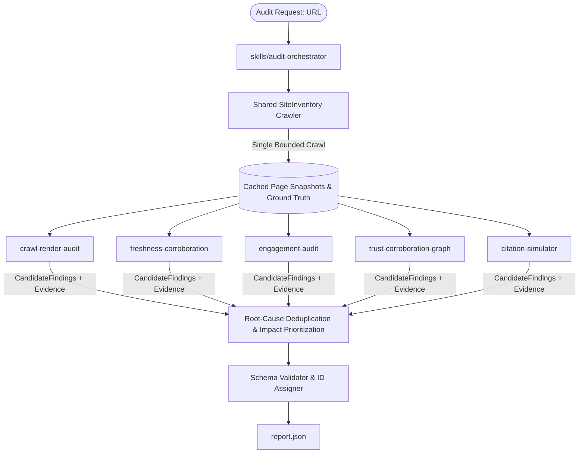

# brand-ai-readiness-audit

An Agent Skill Marketplace that audits a website for AI-discoverability and on-site-engagement
problems and produces a structured report of findings and prioritized fixes. Built for Adobe
University Hackathon 2026, Round 3.

## Entrypoint
`skills/audit-orchestrator` is the single entrypoint that orchestrates the audit.
See `marketplace.json` for the full marketplace manifest.

## Architecture & Skills



| Skill | Concern | What it adds |
|---|---|---|
| **crawl-render-audit** | Off-site discoverability, steps A-C | Is the crawler let in (per AI-agent robots.txt rules, not just `*`)? Can it read the page without executing JS? Is structured data present and valid? Are facts locked inside images/canvas? |
| **freshness-corroboration** | Temporal + internal consistency (Appendix D, half 1) | Claim-based freshness: detects actual stale/conflicting facts (e.g. conflicting founding years, expired promotions) instead of treating missing `dateModified` as a defect. |
| **engagement-audit** | On-site engagement | Evaluates orientation, buttons/forms/CTAs, navigation, redirect-aware broken links, and mobile viewport. |
| **citation-simulator** | Proof-of-failure | Runs the search-fetch-answer loop for realistic questions about the brand, and classifies the result (correct / omission / misattribution / staleness / contradiction). |
| **trust-corroboration-graph** | External identity (Appendix D, half 2) | Do independent third-party sources corroborate the brand's core claims? Can the brand be told apart from other entities sharing its name using Schema.org `sameAs` disambiguation? |
| **audit-orchestrator** (entrypoint) | Composition & Orchestration | Crawls pages once via `SiteInventory`, executes specialist skills to collect `CandidateFindings`, merges and deduplicates by root cause, prioritizes by severity and impact, adds proactive recommendations, and validates the report. |

---

## Key Features & Improvements

1. **Shared SiteInventory:** Pages are crawled once in a bounded, parallelized pass (default 4-6 pages: root, money page, content page, docs/about page). All 5 specialist skills consume the exact same cached snapshots, eliminating redundant network calls and ensuring consistency.
2. **Structured CandidateFindings Contract:** Every specialist skill generates standardized `CandidateFinding` objects directly with concrete evidence and suggested fixes. The orchestrator never invents or hardcodes findings.
3. **Evidence-Verification Layer:** Every finding includes URL, observation, method, timestamp, and confidence rating (`Observed at <url> via <method> [<timestamp>]: <observation> (Confidence: <confidence>)`).
4. **Finding Metadata:** Includes `status` (`confirmed` / `likely-risk` / `proactive`), `confidence` (`high` / `medium` / `low`), and `impact` (`critical` / `high` / `medium` / `low`).
5. **False-Positive Elimination:**
   - Follows HTTP redirects up to 5 hops; links redirecting to 200 are recognized as working.
   - 4xx/5xx responses are distinguished from transient network timeouts.
   - Missing `dateModified` or `datePublished` on static pages is **not** penalized.
   - Breadcrumbs are only evaluated on deep paths (`depth >= 2`), not on root/shallow pages.
   - JavaScript usage alone is **not** a defect if raw HTML contains the core facts.
   - Entity collisions are only flagged if plausible in the same/adjacent industry without `sameAs` disambiguation.
6. **Fact-Extractability Detection:** Analyzes raw HTML vs rendered DOM for crucial facts (pricing, contact, products, policies) and identifies facts trapped inside `<canvas>` or images without alt text.
7. **Advanced Engagement Detection:** Recognizes `<button>`, `<input type="submit">`, `<form>`, `role="button"`, and prominent CTA links.
8. **Root-Cause Deduplication:** Consolidates findings sharing the same fingerprint across pages and skills, merging evidence and assigning highest severity.
9. **Strict Guardrails:** Recommend-only, 100% read-only, respects robots.txt, strictly budgeted under 5 minutes (typical audit runs in 5-20 seconds).
10. **Report Schema Compliance:** Fully conforms to `skills/audit-orchestrator/references/report-schema.json`.

---

## Running the Audit

### 1. End-to-End Orchestrator CLI
To run a complete audit against any website:
```bash
python skills/audit-orchestrator/scripts/run_audit.py https://example.com --output report.json
```

### 2. Standalone Skill CLI
Each specialist script can also be executed independently:
```bash
# 1. Crawlability & Robots Audit
python skills/crawl-render-audit/scripts/crawlability_check.py https://example.com

# 2. Render & Schema Scan
python skills/crawl-render-audit/scripts/render_and_data_scan.py https://example.com

# 3. Freshness & Consistency Scan
python skills/freshness-corroboration/scripts/freshness_and_consistency_scan.py https://example.com

# 4. Engagement Audit
python skills/engagement-audit/scripts/engagement_scan.py https://example.com

# 5. Report Merge & Validation
python skills/audit-orchestrator/scripts/compose_report.py validate --input report.json
```

---

## Running Tests

Run the complete unit and adversarial test suite:
```bash
python -m unittest discover -s tests -v
```
All tests run with Python standard library with zero external dependencies.
